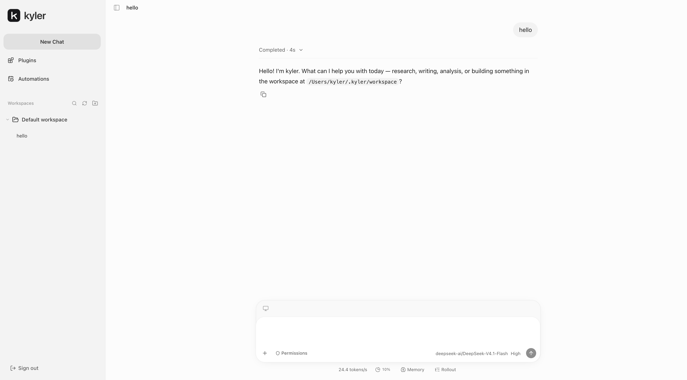
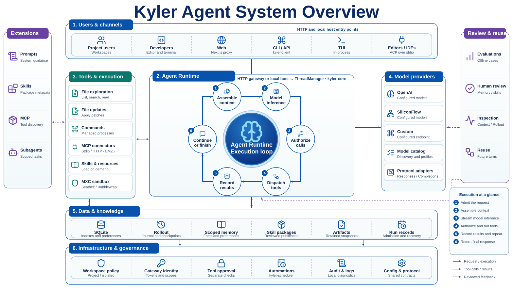

<div align="center">
  <picture>
    <source media="(prefers-color-scheme: dark)" srcset="docs/assets/logo-dark.svg">
    
  </picture>
  <h3>An AI assistant for coding, research, and document work.</h3>
  <p>
    <a href="https://github.com/yeskyler/Kyler/releases"></a>
    <a href="LICENSE"></a>
    <a href="https://github.com/yeskyler/Kyler/stargazers"></a>
  </p>
  <p>
    <a href="docs/development.md"></a>
    <a href="docs/architecture.md"></a>
    <a href="docs/architecture.md"></a>
    <a href="docs/configuration.md"></a>
    <a href="docs/configuration.md"></a>
  </p>
  <p><strong>English</strong> · <a href="README.zh-CN.md">简体中文</a></p>
  <p><a href="#installation">Install</a> · <a href="#demo">Demo</a> · <a href="#architecture">Architecture</a> · <a href="#documentation">Documentation</a></p>
</div>

Kyler is an AI assistant for coding, research, and document work. It combines
conversation, tool execution, and project workspaces to help you understand problems,
complete tasks, and deliver results. Use it through Web, TUI, or CLI.

## Demo

An English conversation in the Kyler Web interface:



## Architecture

Agent Runtime drives the execution loop: **Context → Model → Tools → Results → Context**.
Memory, Skills, MCP tools, sandbox execution, and reviewed experience connect around this shared runtime.



[View the full-size diagram](docs/assets/agent-architecture.svg) · [Explore the architecture](docs/agent-architecture.md)

## Installation

Available for macOS and Linux. Complete bundles include the backend, Web application,
and Node.js runtime.

```sh
curl -fsSL http://www.kyler.work/install.sh -o install.sh
sh install.sh
```

Follow setup to configure the model and access scope. Open the displayed Web address
and sign in with the generated token, or run `kyler tui` for the terminal interface.

```sh
kyler service status   # Check service status
kyler service token    # View the Web token
```

See the [installation guide](docs/installation.md) and [GitHub Releases](https://github.com/yeskyler/Kyler/releases) for details.

## Development

Requires stable Rust and Node.js 24 with npm. See the [development guide](docs/development.md)
for build, startup, and validation instructions.

## Documentation

| Guide | Contents |
| --- | --- |
| [Installation](docs/installation.md) | Setup, service management, and upgrades |
| [Session persistence](docs/session-persistence.md) | Storage and cross-browser recovery |
| [Automations](docs/automations.md) | Scheduled tasks and run history |
| [ACP integration](docs/acp.md) | Editor integration over local stdio |
| [Reviewed learning](docs/learning.md) | Memory candidates and reusable skill drafts |
| [Configuration](docs/configuration.md) | Models, paths, and application settings |
| [Architecture](docs/architecture.md) | Runtime, storage, and execution boundaries |
| [Development](docs/development.md) | Build requirements and validation |
| [Releasing](docs/releasing.md) | Packaging and automated publishing |
| [Troubleshooting](docs/troubleshooting.md) | Installation and runtime issues |
| [Evaluations](docs/evaluations.md) | GAIA and startup performance |

## License

Kyler is released under the [MIT License](LICENSE).
Third-party components retain their respective licenses and notices.

## Star history

<a href="https://www.star-history.com/#yeskyler/Kyler&Date">
  <picture>
    <source media="(prefers-color-scheme: dark)" srcset="https://api.star-history.com/svg?repos=yeskyler/Kyler&type=Date&theme=dark">
    
  </picture>
</a>

[View the interactive chart](https://www.star-history.com/#yeskyler/Kyler&Date).
