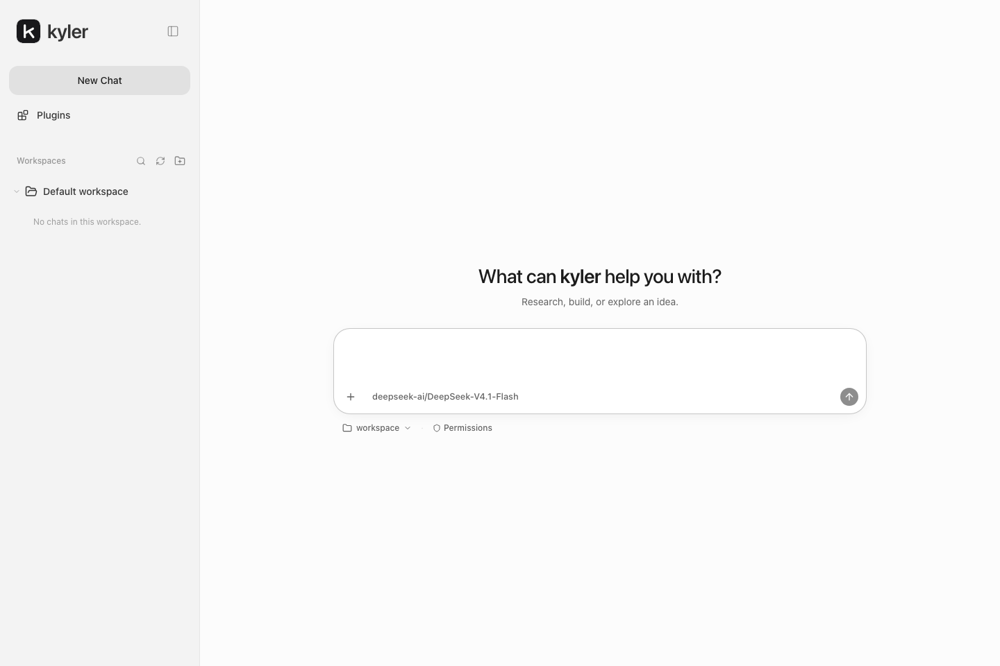

<div align="center">
  <picture>
    <source media="(prefers-color-scheme: dark)" srcset="docs/assets/logo-dark.svg">
    
  </picture>
  <h3>A general-purpose AI assistant for research, creation, and getting things done.</h3>
  <p>
    <a href="https://github.com/yeskyler/Kyler/releases"></a>
    <a href="https://github.com/yeskyler/Kyler/actions/workflows/release.yml"></a>
    <a href="LICENSE"></a>
    <a href="https://github.com/yeskyler/Kyler/stargazers"></a>
  </p>
  <p>
    <a href="docs/development.md"></a>
    <a href="docs/architecture.md"></a>
    <a href="docs/architecture.md"></a>
    <a href="docs/configuration.md"></a>
    <a href="docs/configuration.md"></a>
  </p>
  <p><strong>English</strong> · <a href="README.zh-CN.md">简体中文</a></p>
  <p><a href="#installation">Install</a> · <a href="#capabilities">Capabilities</a> · <a href="#documentation">Documentation</a></p>
</div>

Kyler is a general-purpose AI assistant for research, writing, analysis, and software
development. It combines conversations, tools, and task deliverables in one workspace,
with Web, TUI, and CLI interfaces powered by a shared Rust runtime. Models connect
through OpenAI-compatible Chat Completions endpoints.

<p align="center">
  
</p>

## Capabilities

- Streaming responses, structured tool activity, and persistent conversations.
- File operations, managed commands, sandbox permissions, and execution approvals.
- MCP connectors and system, user, and project skills.
- Image and document attachments, downloadable deliverables, and artifact previews.
- Context management, project memory, and session inspection.
- Asynchronous subagents and independent read-only code reviews.

## Installation

Install from [GitHub Releases](https://github.com/yeskyler/Kyler/releases).
The complete package includes the backend, Web application, and Node.js runtime.

Download and run the installer:

```sh
curl -fL https://github.com/yeskyler/Kyler/releases/latest/download/install.sh -o install.sh
sh install.sh --modify-path
```

Follow setup to configure the model, API URL, API key, and service addresses.
The backend and Web service start automatically. Open **http://127.0.0.1:30002**.

```sh
kyler service status
kyler service stop
kyler service start
```

## Development

Install stable [Rust](https://rust-lang.org/tools/install/) and
[Node.js 24](https://nodejs.org/en/download) with npm.

```sh
git clone https://github.com/yeskyler/Kyler.git
cd Kyler
cargo build --manifest-path kyler-rs/Cargo.toml -p kyler-cli
```

Configure and start the backend:

```sh
export KYLER_CONFIG="$HOME/.kyler-dev/config.toml"
./kyler-rs/target/debug/kyler configure --addresses
./kyler-rs/target/debug/kyler serve
```

Start Web in a second terminal from the repository root:

```sh
export KYLER_CONFIG="$HOME/.kyler-dev/config.toml"
cd web
npm ci
npm run dev -- --hostname 127.0.0.1 --port 30002
```

Open **http://127.0.0.1:30002**. Development and installed services must use separate
ports when running together.

## Documentation

| Guide | Contents |
| --- | --- |
| [Installation](docs/installation.md) | Setup, service management, and upgrades |
| [Configuration](docs/configuration.md) | Models, paths, and application settings |
| [Architecture](docs/architecture.md) | Runtime, storage, and execution boundaries |
| [Development](docs/development.md) | Build requirements and validation |
| [Releasing](docs/releasing.md) | Packaging and automated publishing |
| [Troubleshooting](docs/troubleshooting.md) | Installation and runtime issues |
| [Evaluations](docs/evaluations.md) | GAIA and startup performance |

## License

Kyler is released under the [MIT License](LICENSE).
Third-party components retain their respective licenses and notices.

## Star history

<a href="https://www.star-history.com/#yeskyler/Kyler&Date">
  <picture>
    <source media="(prefers-color-scheme: dark)" srcset="https://api.star-history.com/svg?repos=yeskyler/Kyler&type=Date&theme=dark">
    
  </picture>
</a>

[View the interactive chart](https://www.star-history.com/#yeskyler/Kyler&Date).
