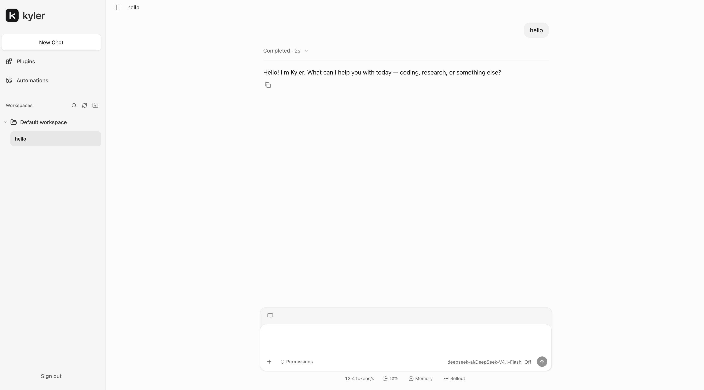
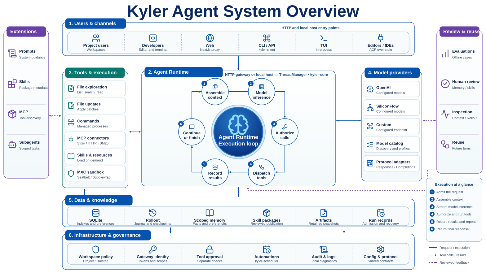

<div align="center">
  <picture>
    <source media="(prefers-color-scheme: dark)" srcset="docs/assets/logo-dark.svg">
    
  </picture>
  <h3>面向编码、研究与日常工作的 AI 助手。</h3>
  <p>
    <a href="https://github.com/yeskyler/Kyler/releases"></a>
    <a href="LICENSE"></a>
    <a href="https://github.com/yeskyler/Kyler/stargazers"></a>
  </p>
  <p>
    <a href="docs/development.md"></a>
    <a href="docs/architecture.md"></a>
    <a href="docs/architecture.md"></a>
    <a href="docs/configuration.md"></a>
    <a href="docs/configuration.md"></a>
  </p>
  <p><a href="README.md">English</a> · <strong>简体中文</strong></p>
  <p><a href="#安装">安装</a> · <a href="#演示">演示</a> · <a href="#架构">架构</a> · <a href="#文档导航">文档导航</a></p>
</div>

Kyler 是一个面向编码、研究与日常工作的 AI 助手。支持 Web、终端界面（TUI）和 CLI。

## 演示



## 架构



## 安装

支持 macOS 和 Linux，完整发行包包含后端、Web 前端和 Node.js 运行时。

Linux 使用系统安装的 Bubblewrap 和网络工具，见 [Linux 依赖说明](docs/linux-sandbox.md)。
两个平台均内置 ripgrep；macOS 使用系统 Seatbelt。

如果安装域名显示备案提示，请直接从 [GitHub Releases](https://github.com/yeskyler/Kyler/releases) 下载。

1. 在同一版本的 **Assets** 中下载适合本机的平台发行包
   （`kyler-vVERSION-TARGET.tar.gz`）、对应的 `kyler-installer-vVERSION-TARGET`
   和 `SHA256SUMS`，放在同一个目录。
2. 将 [`scripts/install.sh`](scripts/install.sh) 保存到该目录并命名为 `install.sh`。
   把命令中的示例文件名换成实际下载的发行包名称。

```sh
sh install.sh --bundle ./kyler-vVERSION-TARGET.tar.gz
```

安装的最后一步会引导配置模型与访问方式，选择“Save and start”即可启动。后续可运行 `kyler configure` 重新配置。打开显示的 Web 地址，使用自动生成的 token 登录。
也可以运行 `kyler`（等同于 `kyler tui`）打开本地终端界面，无需启动后台服务。
如需连接后台服务进行命令行聊天，请显式运行 `kyler chat`。

```sh
kyler service status   # 查看服务状态
kyler service token    # 查看 Web token
```

更多说明见 [安装指南](docs/installation.md) 和 [GitHub Releases](https://github.com/yeskyler/Kyler/releases)。

## 开发

需要 stable Rust 和 Node.js 24（含 npm）。构建、启动和验证步骤见 [开发指南](docs/development.md)。

## 文档导航

| 文档 | 内容 |
| --- | --- |
| [安装](docs/installation.md) | 配置、服务管理和升级 |
| [会话持久化](docs/session-persistence.md) | 存储和跨浏览器恢复 |
| [自动化任务](docs/automations.md) | 定时任务和运行历史 |
| [配置](docs/configuration.md) | 模型、路径和应用设置 |
| [架构](docs/architecture.md) | 运行时、存储与执行边界 |
| [开发](docs/development.md) | 构建环境和验证 |
| [发布](docs/releasing.md) | 打包和自动发布 |
| [排错](docs/troubleshooting.md) | 安装和运行问题 |
| [评测](docs/evaluations.md) | GAIA 与启动性能 |

## 开源协议

Kyler 采用 [MIT License](LICENSE) 开源。
第三方组件保留各自的许可证和声明。

## 仓库人气记录

<a href="https://www.star-history.com/#yeskyler/Kyler&Date">
  <picture>
    <source media="(prefers-color-scheme: dark)" srcset="https://api.star-history.com/svg?repos=yeskyler/Kyler&type=Date&theme=dark">
    
  </picture>
</a>

[查看交互图表](https://www.star-history.com/#yeskyler/Kyler&Date)。
