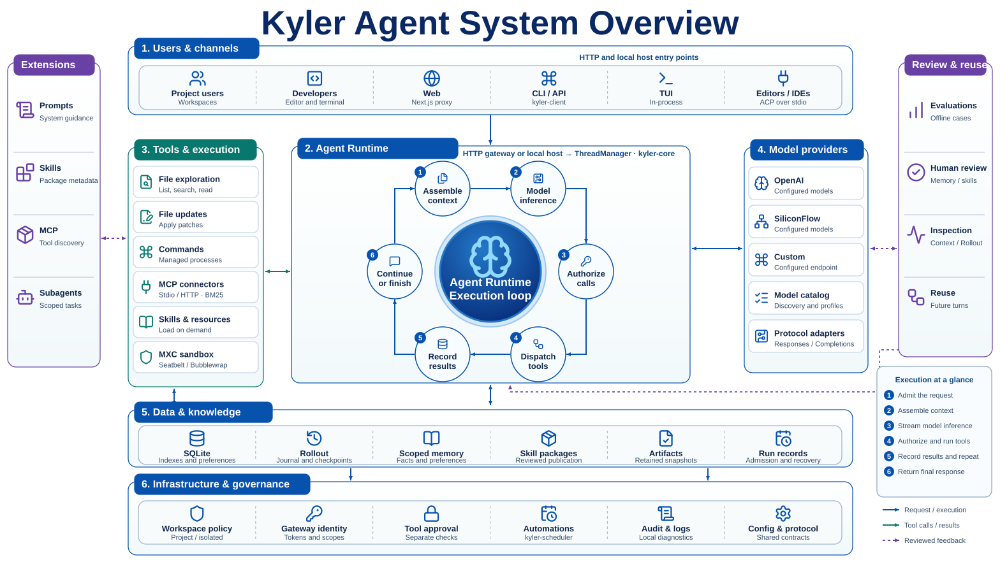
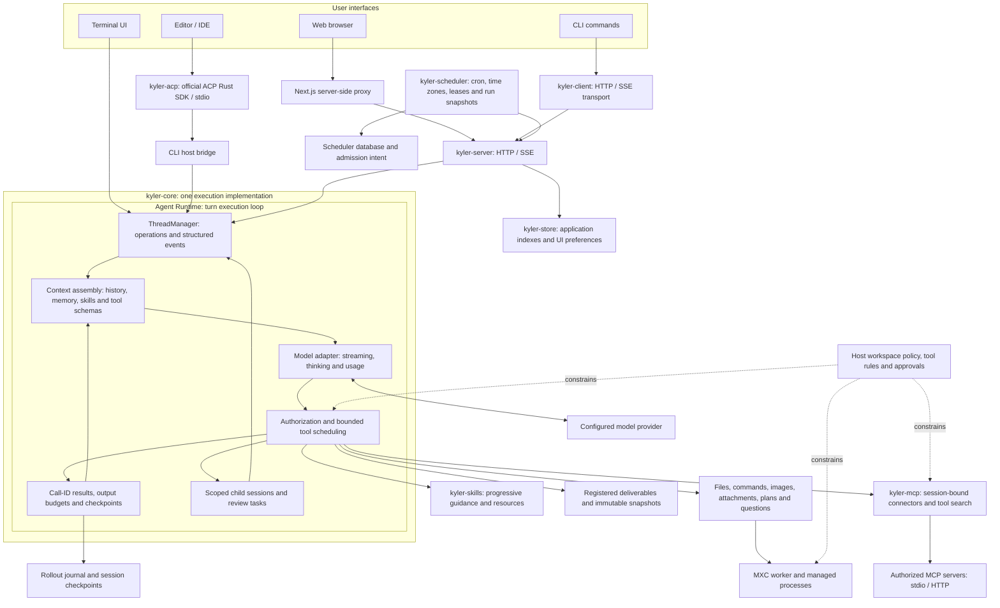
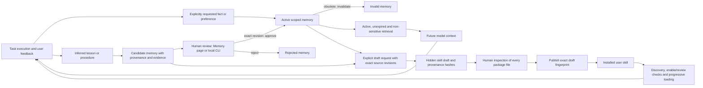
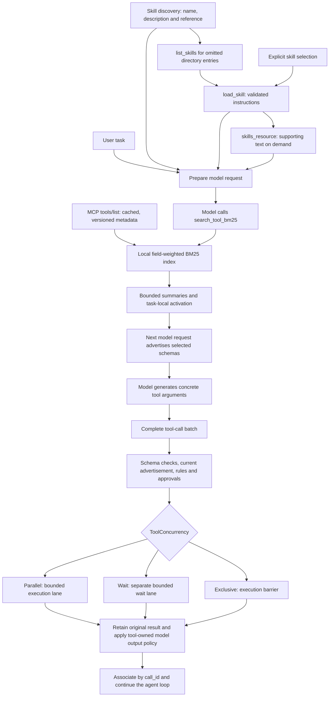

# Kyler Agent Architecture

Implementation snapshot: **19 November 2026**. This overview describes the current
workspace, including reviewed memory and skill drafts. Boxes describe ownership
and data flow; they are not separate deployed services unless stated explicitly.
The overview centers **Agent Runtime** and shows its clockwise execution loop:
**Assemble Context → Model Inference → Dispatch Tools → Record Results → Assemble
Context**. The loop ends on a final answer, cancellation or an execution limit.

ThreadManager admits turns above the runtime. Memory and Skills supply context on
the left; model inference, tools, MCP and sandbox execution connect on the right.
Persistence and user-visible results sit below it. The outer experience feedback
path returns reviewed knowledge to future turns. Blue arrows mark the execution
loop, solid gray arrows mark calls/data, and dashed green arrows mark policy or
reviewed feedback.

[Open the full-size SVG](assets/agent-architecture.svg). The SVG is editable and
can be embedded in presentations or documentation.

## Execution and integration flow

Web sessions enter through HTTP; TUI uses core directly; ACP uses a CLI-owned
host bridge. The local `learning` CLI reviews memory and skill drafts directly,
without a model call. These adapters share execution logic but retain separate
session-store namespaces. Server-side credentials stay outside browser payloads.

## Reviewed experience and self-evolution

The current self-evolution mechanism is **experience capture and human-reviewed
reuse**, implemented through Memory and Skills. It does not autonomously rewrite
agent code or system prompts.

- The host records session, execution and tool-call provenance. Evidence references
  are claims to inspect, not automatically verified facts.
- Candidate proposals cannot overwrite reviewed entries. Explicit saves follow
  their existing revision rules; inferred candidates require a review operation
  to become active. Expired, rejected, invalid and sensitive entries are excluded
  from context retrieval.
- A draft can use eligible candidate or active sources with exact revisions. Its
  provenance is a snapshot, not a live synchronization link. Drafts remain hidden
  from skill discovery until explicitly published.
- Publication checks the draft fingerprint and, for replacements, the installed
  fingerprint. User skills can be available across sessions under existing
  enable/disable rules; memory remains bound to its resolved scope.
- Web review lives in **Memory** and **Plugins → Skills → Drafts**. There is no
  separate Learning page. The local CLI retains the `learning` command.

Automatic semantic deduplication, source-change invalidation, full revision rollback,
background learning jobs and automatic promotion/publication are not implemented.

## Tool discovery and execution policy

MCP discovery does not block the first model request on every connector. Ready
connectors contribute catalogs while other connections continue. Search is explicit,
uses local BM25 metadata matching and a query cache, and does not use a vector
database. A match activates tools for the next model request; it grants no new
connection or execution permissions. Activation and indexes are scoped to the task.

The model's `parallel_tool_calls` hint and runtime scheduling are independent.
Adjacent eligible calls run with bounded concurrency; exclusive tools form barriers.
Wait operations have their own bounded lane. Authorization updates durable state
before execution. The runtime does not infer command dependencies or prevent file
conflicts across sessions or subagents. Streamed tool preparation is visible, but
partial arguments never execute; streaming early execution is not implemented.

## Capability and ownership map

| Area | Current features | Owner |
| --- | --- | --- |
| Interfaces | Web chat, TUI, CLI, ACP editor integration | `web/`, `kyler-tui`, `kyler-cli`, `kyler-client`, `kyler-acp` |
| Runtime | Shared thread operations, streaming loop, cancellation, execution limits, model snapshots and thinking preferences | `kyler-core` |
| Concurrency | Parallel/exclusive/wait scheduling, independent child sessions, bounded delegation and task review | `kyler-core` |
| Tools | Focused reads/searches, patches with change statistics, commands, process input/poll/terminate, images and attachments | `kyler-core` |
| Interaction | Plan updates, human questions, tool approvals and structured progress events | `kyler-core`, client adapters |
| MCP | Stdio/HTTP transports, connection lifecycle, paginated discovery, catalog refresh, BM25 search and task-local activation | `kyler-mcp`, core policy adapters |
| Skills | Built-in/user/project discovery, precedence, exact-version review, directory budgets, instruction/resource loading, package install/save and hidden drafts | `kyler-skills`, core policy adapters |
| Memory | Scoped facts/preferences/lessons/procedures, lifecycle and expiry, provenance, revision checks and bounded retrieval | `kyler-core`, shared protocol contracts |
| Experience reuse | Candidate review, source-bound skill drafting, file inspection and fingerprint-checked publication | Memory/Skills APIs and Web views; local CLI |
| Workspace safety | Authorized project roots, optional private directories, filesystem/network/process policy and separate tool approval | Core workspace/sandbox policy and host adapters |
| Persistence | Append-only Rollout, checkpoints, run manifests, SQLite indexes, preferences, scoped memory files and skill review records | Core session store, `kyler-store`, `kyler-skills` |
| Automations | Cron/time zones, immutable run snapshots, fenced leases, bounded concurrency and restart reconciliation | `kyler-scheduler`, server adapter |
| Deliverables | Explicit artifact registration, immutable retained copies, previews/downloads and attachment handling | Core registration, server retention, Web renderers |
| Visibility | Context/Memory/Rollout inspection, token/usage accounting, compaction lifecycle and structured logs | Core projections, Web/TUI adapters, `kyler-logging` |
| Shared foundations | Typed events/APIs/prompts, configuration/credential resolution, evaluations and startup measurements | `kyler-protocol`, `kyler-config`, `kyler-evals` |

## Storage and authority boundaries

- **Project sessions** operate on the authorized project directory and share files
  with other sessions using it. **Isolated sessions** operate in host-owned private
  directories; a linked project is metadata, not an access grant. Child agents can
  share their parent's workspace, so concurrent writes can still conflict.
- Rollout and checkpoints retain conversation truth. `kyler-store` provides SQLite
  infrastructure and application indexes; it does not execute tasks, interpret
  journals or grant workspace permissions. The scheduler owns its separate schema.
- Memory uses scoped files with atomic writes and revision checks. Skill packages,
  hidden drafts and review records retain their own file-based persistence.
- Sandbox permissions and tool approval are separate checks. Client selections,
  MCP search results and enabled skills cannot exceed the host policy ceiling.
- SSE replay supports reconnecting clients without rerunning a prompt. Durable run
  admission/deduplication is separate from transient streaming and tool progress.

See [detailed architecture](architecture.md), [reviewed experience](learning.md),
[session persistence](session-persistence.md), [automations](automations.md) and
[ACP integration](acp.md) for implementation details.
