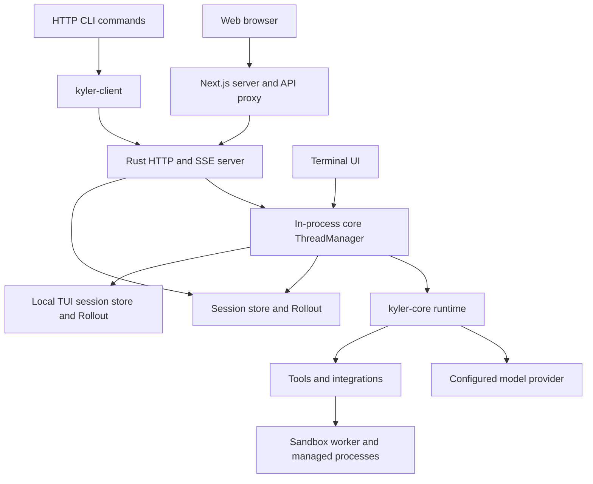

# Architecture

Kyler combines a Rust agent backend with Web, TUI, and CLI clients. The installed
`kyler` executable includes the CLI, server launcher, TUI, and internal worker entry.
The standalone Web application runs in a separate Node.js process.

## Request path

Web keeps provider and backend credentials server-side. HTTP requests and SSE carry
structured state and events; clients render text, tool activity, approvals, questions,
and artifacts through their respective views.

## Rust modules

| Crate | Responsibility |
| --- | --- |
| `kyler-cli` | Command parsing, setup, service lifecycle, and launch entry points |
| `kyler-server` | HTTP routes, SSE cache/replay, durable admission, host workspace binding |
| `kyler-scheduler` | SQLite-backed automation schedules, leases, run snapshots, and recovery |
| `kyler-tui` | Terminal interaction and in-process core operation/event adaptation |
| `kyler-client` | Rust HTTP/SSE transport and typed client operations |
| `kyler-core` | Agent threads, runtime, tools, sessions, context, memory, sandbox, integration policy |
| `kyler-store` | Shared SQLite infrastructure, scoped session/run indexes and UI preference persistence |
| `kyler-skills` | Skill discovery, package validation, reviewed versions, caches, resources and package storage |
| `kyler-mcp` | MCP protocol sessions, connection lifecycle, immutable catalogs, calls and local metadata search |
| `kyler-protocol` | Shared contracts, event metadata, prompts, and agent names |
| `kyler-config` | Configuration loading, defaults, validation, credential resolution |
| `kyler-logging` | Logging configuration and initialization |
| `kyler-evals` | GAIA evaluation and startup measurement executables |

Rust crates are located in `kyler-rs/crates/`. Web source is located in `web/` and
mirrors the public contracts in its frontend types and event adapters.

## Runs, sessions, and history

`kyler-store` depends on shared protocol contracts, not on core or scheduler.
It owns SQLite opening, private file permissions, connection serialization,
blocking-task execution and transactional schema migration. Its application
catalog accepts typed index records; it never reads session journals or interprets
agent events. Core retains summary/preview generation, journal signatures, draft
markers and index-repair orchestration. The existing core catalog facade preserves
call sites while delegating SQL and preference persistence to `kyler-store`.

Scheduler reuses the SQLite infrastructure while retaining its schema SQL, lease
validation, admission intent and state transitions. `app.sqlite3` (schema v3) and
`scheduler.sqlite3` (schema v1) remain separate. Migration versions are rechecked
inside an immediate transaction; failed migrations roll back and newer schemas
are rejected. Database code does not grant workspace authority. Rollout, memory
files and skill review records keep their existing persistence paths.

A session associates conversation state with a project identity and a private execution
workspace. A run executes one admitted request, with its own execution state and
cancellation. Different sessions may run concurrently within server limits; overlapping
turns in the same session are restricted to preserve history ordering.

The runtime prepares a model request, receives text/tool calls, validates and executes
tools, records their results, and continues until completion or a configured execution
limit is reached. Managed commands can return a process ID while still running.
Subagents are optional independent child sessions managed by delegation tools; a child
does not recursively inherit subagent-management tools.

Session lists and shared Web preferences use a scoped SQLite application database.
See [Session persistence](session-persistence.md) for indexing, migration, and browser
recovery behavior.

Persistent sessions use an append-only `rollout.jsonl` journal and snapshots for loading
and recovery. TUI and Web consume shared structured history rather than reconstructing
tool state from plain assistant text.

## Command lifecycle

Models use `shell` for one-shot argv execution and retain `exec_command` and
`write_stdin` for ongoing processes. Shared execution parameters and validation live
in `tools/shell.rs`; there is no `tools/command.rs`. `shell` closes stdin, waits for
exit or its bounded timeout, returns output and exit status without a process
session ID, and cleans up its private process entry on exit or cancellation.
Its default timeout is the host command timeout; explicit values remain bounded by
the host background timeout.

 `exec_command` accepts a complete
`command` string, executed through `/bin/sh -c` within the existing authorized
sandbox. Optional working directory, child environment, total timeout and initial
wait retain the host's limits. Repeating an identical running command in the same
chat is rejected with its existing process session ID. Ordinary shell syntax does
not grant permissions beyond the sandbox or approval policy.

Running commands return a process `session_id`, distinct from the chat session ID.
`write_stdin` waits for new output when `chars` is empty/omitted, sends nonempty
input, sends EOF with `close_stdin`, or stops the process group with `terminate`.
Reads are serialized per process and use host-owned cursors. Terminal sessions
retain remaining output and exit codes; input to ended sessions is explicitly not
sent. Reads do not repeat already consumed output. Output is bounded and model
summaries preserve status and exit codes. No PTY is advertised or implemented;
Ctrl-C bytes are ordinary pipe input, so use `terminate` to interrupt.

The existing manager retains at most four active processes per chat and 128 total
entries, with bounded output; completed entries can be evicted at capacity.
Legacy process tools and the internal `run_command` worker transport remain
available to historical/internal code but are not advertised by the default agent.
Existing legacy deny/ask rules apply to corresponding new operations unless an
explicit new-name rule overrides them. Web and TUI use existing structured events.

## Focused file operations

Agent instructions favor small, coherent patches; related file operations may share
a call. Existing files are read and updated with minimal context instead of being rewritten.
Large new files can be built through complete successive patches; each call remains
independently valid and the agent must finish the full deliverable. This is guidance,
not a hard size cap, and it does not remove the need to finish generating new content.
Before writing, the patch worker verifies all operations against staged file contents,
including sequential edits and moves. Verification failures leave files unchanged;
commit-time filesystem failures can still leave partial changes. Errors identify the
file and hunk and guide a corrected retry. Malformed patches and existing-file errors
require checking actual file state before a smaller corrected retry. Optional tool fields use host defaults when omitted.

### Patch generation budgets

`apply_patch` accepts at most 16 KiB of UTF-8 JSON arguments per call; the tool and
approval path enforce the same limit. Instructions group complete features or related
changes without a fixed line count; medium patches typically target about 8–12 KiB,
while small files may be created completely in one call. Larger changes split at
functional boundaries when necessary. After a budget interruption, retry a
substantially smaller coherent subset and reduce further on repeated interruptions.
These are prompt-level planning targets, not additional runtime limits. Rejected
full patches must not be resent unchanged or moved into shell commands. Streaming responses
are interrupted as soon as accumulated patch arguments exceed the byte budget.
A fixed 120-second generation deadline starts when `apply_patch` is identified and
ends at the finish reason; ongoing fragments do not reset it. Existing connection
and idle timeouts remain in effect. This deadline does not bound preceding reasoning
or waiting for the first tool identity, nor does it change tool execution timeouts.

Before any tool in a rejected response executes, the streamed agent loop may request
a smaller complete call, at most twice per run and within its existing step budget.
Partial arguments are never executed or included in recovery instructions. Exhaustion
returns `model_patch_generation_limit`. Non-streaming calls are checked after receipt;
this does not impose a generation-time deadline on non-streaming provider responses.
These bounds do not guarantee lower total latency or prevent provider-side stalls.

## Deliverables

The `register_artifacts` tool replaces the current execution's deliverable list with
explicit file paths, optional display names, and at most one primary file.
Omitted names default to the decoded source filename. A custom name without an
extension receives the source extension; conflicting extensions remain invalid.
Registration validates workspace access and the per-file size limit without granting additional permissions.
At successful completion, the server retains immutable snapshots before publishing the
terminal run event. Registration state belongs to one execution and does not carry
forward into later turns.

Registered files define the output list. When no files are registered, local links in
the final response remain supported for compatibility. The host does not scan workspace
directories for deliverables. Local dependencies of retained HTML and Markdown files
remain hidden from the top-level list. Web opens the output panel for new available
deliverables, preferring a previewable primary file, then another previewable
deliverable, then a download-only file.
Uploaded files and supporting resources do not trigger automatic opening. An open
panel keeps its selection; closing it suppresses reopening during the same run.
File-loading failures show an error and a retry control.

XLSX and PPTX previews use `@vue-office/excel` and `@vue-office/pptx` in read-only,
opaque-origin iframes. The Web build bundles the components, Vue runtime, compatibility
layer, and styles as local static assets. The parent validates file size and ZIP
expansion limits before passing bytes to each frame; it does not pass service
credentials. Frames permit local blob reads and block remote resource connections.
Removing a frame releases the component's global event handlers and document resources.

PPTX preparation runs in a Worker and removes dangling content-type declarations from
a preview copy, preserving the original download. Previews support at most 100 slides
and 20 MiB of compressed input. Page navigation and scaling reuse rendered slides and
preserve the presentation's page ratio. Advanced chart styling, animations, and embedded
media depend on the renderer's capabilities.

## Context and memory

Context management builds a bounded model-facing view, preserves the current question,
and compacts history according to the configured window and summary policy. Large tool
outputs can have a compressed model view while retaining their original output in
history.

Each tool owns its model-facing output policy through `Tool::compress_output`.
Runtime supplies the byte budget and retains the original result; it does not
choose which domain fields to omit. Budget/result types live beside the tool
trait in `tools.rs`, alongside text-boundary and entry-fitting primitives. The
existing `subagent.rs` owns the structured result policy shared by subagent tools.
Other tools keep their own
compression methods, including pagination and omission notices.

Text estimates use `tiktoken-rs`, with `o200k_base` as the default encoding. Model
profiles can explicitly select `cl100k_base`. The legacy `conservative` setting is
accepted as an alias for `o200k_base`; there is no byte-counting fallback. These
encodings remain estimates for providers using different tokenizers. Provider-reported
input usage takes precedence in the context inspector when available. Images retain
a separate visual-token allowance.

Context compaction records a durable lifecycle with a stable identifier, timestamps,
and status. The service streams these updates through `context_compaction` events
and includes them in session history. Web and TUI render one separator per lifecycle,
updating its status when compaction completes, fails, or is cancelled. History replay
marks unfinished lifecycles as interrupted rather than leaving an active indicator.
These records contain no summary text and are excluded from model requests and
summary input.

Session summaries are part of session state. Long-term project facts are explicitly
managed by the `memory` tool and stored separately by the service, scoped to the
resolved project/session identity. Only explicit memory operations create or update
these facts. Rollout, Memory, and Context inspectors expose different views of this
state.

## Trust and execution

The host creates an execution environment with a workspace, working directory,
filesystem grants, network policy, process limits, and a worker path. Tools declare
execution placement and operation metadata. Tool dispatch validates arguments, checks
rules and approval, and executes under the effective host-authorized policy.

Isolated file/command work uses the sandbox worker. Host-managed processes retain
session ownership while command execution uses the worker boundary. MCP tools use
session-bound connections and still depend on remote credentials and permissions. Skills
provide instructions and resources; enabling a skill does not increase authority.

Product instructions are maintained in `kyler-rs/crates/kyler-protocol/src/prompts/`,
separate from the repository's [AGENTS.md](../AGENTS.md). See
[configuration](configuration.md), [development](development.md), and [security
guidance](../SECURITY.md).

## Skills boundary and progressive loading

`kyler-core` depends on `kyler-skills`; the skill crate never depends on core or
runs scripts, model requests, commands or connectors. The compatibility facade at
`kyler_core::skills` preserves `SkillManager`, `SkillSnapshot`, archive helpers and
catalog imports. Built-in packages are embedded in the new crate; their virtual
paths and fingerprints remain stable.

The standalone manager treats configured user/project source directories as
host-authorized skill control-plane roots. Arbitrary local imports and project
writes use the `SkillFileAccess` interface; core adapts its `FilesystemPolicy`,
including restrictions on protected descendants during package replacement. Skill
package checks still reject traversal and symlinks, securely open resource files,
and bound package size, depth and entry counts. Skill activation is permission to
load guidance, not permission to execute its contents.

Directory caches are keyed by canonical workspace and use per-workspace scan locks.
Metadata signatures trigger content rescans; a configurable periodic full scan
also detects changes. Cached packages are shared through immutable references.
Timestamps only help invalidation: loading instructions/resources still validates
the entire package content fingerprint and current enable/review records. Project
skills override user and built-in copies, require exact-fingerprint review, and do
not silently fall back to a lower-priority copy when disabled or invalid.

Core renders directory metadata using the bound model tokenizer, with explicit
selections prioritized. Omitted entries remain discoverable via versioned
`list_skills` pages; full instructions are loaded through `load_skill`, resources
through `skills_resource`. Full instructions are never truncated by the directory
budget. Binary resource bytes can be read by the package API; model text tools
reject non-UTF-8 resources and leave parsing/preview/execution to existing tools.

`CreateRunRequest.skills` and `UserTurn.skills` accept bounded ID/fingerprint
references. Core validates them, loads the selected version before the first model
request, records canonical skill tool events and persists selections for resume.
Legacy `@skill-name` and `$skill-name` inputs follow the same loading path.
Existing Web/TUI skill markers remain supported; the typed request field is
available to API and in-process clients. Request/operation deduplication includes
nonempty selections while preserving historical hashes for legacy empty selections.

## MCP transport and retrieval boundary

`kyler-core` depends on `kyler-mcp`; the MCP crate does not depend on core. The
core `McpManager` remains the compatibility facade for session scopes, connector
installation and persistence, system discovery, and host policy. It supplies a
`TransportFactory` that creates authorized HTTP clients or sandboxed stdio streams.
Full schemas are shared through immutable catalog entries instead of cloned on
every model step. The MCP crate owns the resulting protocol session, discovery pagination, immutable
catalog versions, list-change refresh, bounded calls, cancellation and disconnect.
Host process leases implement `TransportGuard`; cancelled handshakes stop their
processes as well as established connections.

`kyler-mcp::search::ToolIndex` owns a bounded, field-weighted BM25 index and a
catalog-local query cache. Search summaries contain no full schemas, credentials,
or transport handles. The core runtime owns task-local activation, schema token
budgets and the `search_tool_bm25` adapter. Finding a tool never grants authority.
Only tools advertised in the current model request can execute; tools activated
by search are advertised on the next request. New tasks advertise no concrete MCP
tools until explicit search, including small catalogs; automatic task-query
selection is disabled. The adapter lives in `kyler-core/src/tools/search_tool_bm25.rs`.

Runtime discovery uses the nonblocking `snapshot_ready` path. Healthy connectors
are usable while other handshakes continue. Explicit `@connector:id` references
can wait for a configured bound; they do not authorize new connections. The
legacy `snapshot` method retains its waiting behavior for explicit API consumers.
Connection/scope binding and policy filtering are unchanged. Catalog changes and
reconnections rebuild the task index and invalidate removed or changed entries.
Indexes and activation are never shared across sessions or child executions.

## Project execution in Web and TUI

TUI runs `ThreadManager` and the agent loop inside the terminal process. It never
uses `kyler-client`, backend HTTP/SSE routes, service discovery, or service tokens.
`kyler tui --session <id>` resumes a local session; `--server` is rejected for TUI.
New sessions bind to the current directory. Resumed sessions retain their original
workspace and must match the current host sandbox policy.

`kyler-core/src/thread/` owns thread creation, bounded operation/event channels,
turn execution, cancellation, preferences, and shutdown. `kyler-tui/src/agent.rs`
adapts those operations and events to the terminal state. The existing core agent
loop remains the only execution implementation. Local model configuration is
loaded independently of client, backend, and Web transport settings.

Local sessions are stored in `tui/sessions` beside the configured session directory
(normally `~/.kyler/tui/sessions`). A lifetime file lock prevents two TUIs from
opening the same session. Different sessions can run concurrently. Approvals,
questions, and managed process records are scoped to the owning session. Exiting
TUI cancels active work and awaits checkpoint and resource cleanup.

Web retains its HTTP/SSE architecture and server-authorized project workspaces.
The server attaches hosted sessions to the same core `ThreadManager`. Both adapters
submit `ThreadOp` for turns, cancellation, approvals, questions, model selection,
and permission changes. Core owns execution, timeout accounting (excluding human
waits), session checkpoints, and terminal events. A hosted turn includes an explicitly
host-authorized agent/session and retains the service's admitted run ID as its operation ID.

`kyler-core/src/thread/protocol.rs` defines operations and notifications with
thread ID, operation ID, execution ID, and sequence number. `handle.rs` owns operation
submission and read-only queries; `runner.rs` is shared by both entry points.
`kyler-server/src/threads/` adapts host contexts and consumes each core stream through
one serialized bridge. SSE clients read the service cache and never compete for
core events. Slow or disconnected browsers do not cancel execution. Service
shutdown cancels active work, joins hosted threads, then shuts down shared resources.
Closing one hosted thread cannot stop another thread's MCP or process manager.
The service releases idle execution actors after each run; the next request restores
state from the existing session and preference files. Durable HTTP admission keys
continue to prevent duplicate execution across actor recreation and service restarts.

HTTP validation, durable request deduplication, global capacity, admission records,
SSE retention/replay, and restart manifests remain service responsibilities. Core
also rejects conflicting operation-ID reuse within a live thread. Service model
and permission files keep their existing format; TUI storage remains independent.
History and tool-detail projections are shared in core.
Both paths use the shared core workspace factory and retain the same host sandbox
ceiling. Permission selections can narrow this ceiling but cannot expand it.
Web executes in the selected project or the server-configured default directory,
validated against the server's allowed roots. Existing private sessions are not
migrated. Sessions in the same project share files, so simultaneous edits can
conflict; project memory retains its existing project scope.

## Private session execution

Sessions use `cwd` as the execution directory. Relative file, patch, command, and
artifact paths resolve from that directory. Changing a command's `working_directory`
affects only that invocation. Neither setting grants filesystem access: the host
filesystem and sandbox policy are checked independently.

The serialized environment separates `cwd`, optional `project` grouping metadata,
optional `managed` directory ownership, and a host-revalidated `sandbox` binding.
The binding's base directory reconstructs the saved host policy; tools do not use
it as their working directory. Project grouping does not authorize reading the
project or other sessions.

Ordinary new sessions work directly in the requested authorized `cwd` or the
server's default directory. Sessions with the same cwd share disk files, while
history and task state remain separate. This does not introduce cross-session file
locks. Use distinct directories when concurrent edits must not share a working copy.

Explicit isolated-mode API requests and automation runs allocate an empty directory
under `<session.directory>/_execution/<session-id>/workspace/` before starting core.
The saved `managed.root` identifies that host-owned directory. The server verifies
its owner and narrows access when restoring it. Missing directories fail closed;
project files are never automatically copied or relocated. Child agents inherit
the parent's directory, and deleting a child cannot remove the parent's workspace.

Session creation accepts `cwd` and an optional explicit `workspace_mode` for
server-managed isolation. Session summaries expose `cwd` and optional `project`
grouping. Removed directory aliases are rejected rather than silently interpreted.
Saved environments use the same canonical structure; old environment records must
be exported or migrated separately before upgrading.

Artifacts resolve relative to cwd, then retain immutable copies associated with the
session and execution. Explicit sources outside cwd must pass read permissions.
Deleting an ordinary session removes its history, attachments, and artifact copies,
never its project directory. Only verified host-managed private directories are
removed with their owning session.

## Tool progress events

While a model streams tool calls, `tool_call_delta` announces the call ID and the
accumulated name so Web and TUI can display preparation before arguments finish.
Partial arguments are neither published nor executed. Identity updates reuse the same
card; cancellation or failure settles unfinished preparation along with queued tools.

After recording a model's complete tool-call batch, the runtime emits `tool_queued` for
every call before authorizing and executing calls in order. `tool_started` means
execution has begun; `tool_finished` also covers calls refused by approval. Web and TUI
update existing nodes by call ID, distinguish queued and approval waits, and settle
unfinished nodes when a run ends. History uses retained presentation timestamps to
distinguish calls that have not started.

The Web client loads successful plan-tool details independently of the SSE event loop,
with a timeout and protection against older results replacing newer plans. Tool
execution remains serial within each batch.

## Session thinking preference

`GET/PUT /v1/sessions/{id}/thinking` exposes credential-free thinking state and available `high/max` levels.
Updates use the thread operation queue and an atomic session-owned preference
sidecar, separate from active execution checkpoints. The preference survives restart
and is applied to a copied model snapshot at the next turn admission; an active
execution keeps its existing setting. Sessions default to High. Old Off/false preferences resolve to High without being
rewritten on read; new Off selections are rejected. Low-level Off serialization
remains for compatibility with embedded callers.
SiliconFlow DeepSeek-V4-Flash maps High/Max to distinct `reasoning_effort` values;
Off disables thinking and omits effort. Explicit levels are independent of model-name recognition.
Model-name recognition chooses automatic defaults only. Any bound model can save
an explicit thinking selection; provider parameter compatibility is validated by
the provider. The menu remains visible rather than silently disappearing for an
unrecognized model name.

Provider parameter reference: [SiliconFlow Chat Completions](https://docs.siliconflow.cn/docs/api/chat-completions-post).

### Patch change statistics

Successful `apply_patch` output is a structured `patch_result` containing
workspace-relative file paths, operation labels, previous paths for renames, and
added/removed line counts. Update counts exclude context; additions count written
lines and deletions count original lines, including a final unterminated line.
Repeated operations aggregate per file, and pure renames report zero changed lines.
Preflight failures report no successful changes. Commit I/O failures return an
error/partial result containing only confirmed operations and an inspection warning
for the failing file; runtime dispatch records these as tool errors, not success.
The files are not updated transactionally.

Durable tool output retains the report. Both tool-finished events and history
projection include optional patch metadata, independent of textual preview
truncation. Older events/output remain valid and show no guessed statistics.
Web uses green additions, red deletions, blue modifications, neutral renames and
amber partial-application notices, with symbols and labels in both themes. TUI
shows matching colored totals and file details; text and symbols remain useful
without color. No tool arguments are parsed to estimate completed changes.

## Subagent task tools

The model-facing subagent tools are `delegate_task`, `wait_tasks` and `cancel_task`.
`wait_tasks` lists tasks when IDs are omitted, inspects selected tasks immediately
with `timeout_secs=0`, and waits for any/all selected tasks with a positive timeout
(default 20 seconds, capped by host policy). `task_id` is a singular alternative to
`task_ids`; supplying both is rejected. All selected tasks remain scoped to the
parent execution. Review pagination requires exactly one ID, `timeout_secs=0` and
`review_section=overview/findings/files/limitations`; continue with
`review_offset=next_offset`. The separate `get_task` entry is no longer advertised.
