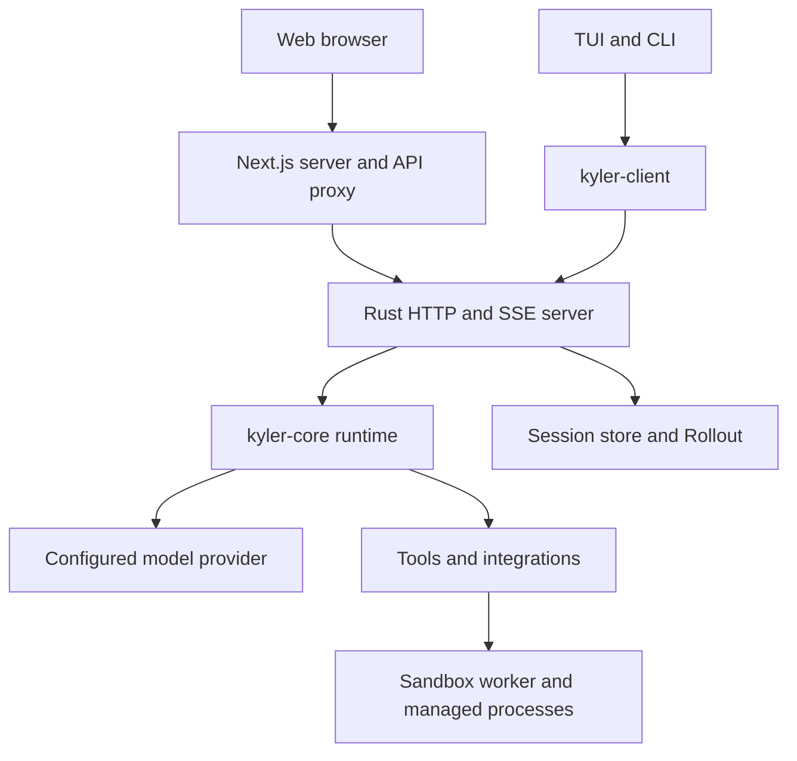

# Architecture

Kyler combines a Rust agent backend with Web, TUI, and CLI clients. The installed
`kyler` executable includes the CLI, server launcher, TUI, and internal worker
entry. The standalone Web application runs in a separate Node.js process.

## Request path

Web keeps provider and backend credentials server-side. HTTP requests and SSE
carry structured state and events; clients render text, tool activity, approvals,
questions, and artifacts through their respective views.

## Rust modules

| Crate | Responsibility |
| --- | --- |
| `kyler-cli` | Command parsing, setup, service lifecycle, and launch entry points |
| `kyler-server` | HTTP routes, SSE, run admission, cancellation, workspace binding |
| `kyler-tui` | Terminal interaction, input, and structured history rendering |
| `kyler-client` | Rust HTTP/SSE transport and typed client operations |
| `kyler-core` | Runtime, tools, sessions, context, memory, sandbox, integrations |
| `kyler-protocol` | Shared contracts, event metadata, prompts, and agent names |
| `kyler-config` | Configuration loading, defaults, validation, credential resolution |
| `kyler-logging` | Logging configuration and initialization |
| `kyler-evals` | GAIA evaluation and startup measurement executables |

All crates live under `kyler-rs/crates/`. Web source lives under `web/` and mirrors
the public contracts in its frontend types and event adapters.

## Runs, sessions, and history

A session binds conversation state to a workspace. A run executes one admitted
request, with its own execution state and cancellation. Different sessions may
run concurrently within server limits; overlapping turns in the same session are
restricted to preserve history ordering.

The runtime prepares a model request, receives text/tool calls, validates and
executes tools, records their results, and continues until completion or a bound
is reached. Managed commands can return a process ID while still running.
Subagents are optional independent child sessions managed by delegation tools;
a child does not recursively inherit subagent-management tools.

Persistent sessions use an append-only `rollout.jsonl` journal and snapshots for
loading/recovery. TUI and Web consume shared structured history rather than
reconstructing tool state from plain assistant text.

## Context and memory

Context management builds a bounded model-facing view, preserves the current
question, and compacts history according to the configured window and summary
policy. Large tool outputs can have a compressed model view while retaining their
original output in history.

Session summaries are part of session state. Long-term project facts are explicitly
managed by the `memory` tool and stored separately by the service, scoped to the
resolved project/session identity. They are not automatic copies of every turn.
Rollout, Memory, and Context inspectors expose different views of this state.

## Trust and execution

The host creates an execution environment with a workspace, working directory,
filesystem grants, network policy, process limits, and a worker path. Tools declare
execution placement and operation metadata. The tool path validates arguments,
checks rules and approval, and executes under the effective host-authorized policy.

Isolated file/command work uses the sandbox worker. Host-managed processes retain
session ownership while command execution uses the worker boundary. MCP tools use
session-bound connections and still depend on remote credentials and permissions.
Skills provide instructions/resources; enabling a skill does not increase authority.

Product instructions live in `kyler-protocol/src/prompts/`, separate from the
repository's [AGENTS.md](../AGENTS.md).
See [configuration](configuration.md), [development](development.md), and
[security guidance](../SECURITY.md).

## Private session execution

The workspace selected by a client is a project grouping, not a shared execution
root. Each managed session receives a private directory under
`<session.directory>/_execution/<session-id>/workspace/`. Its serialized environment
stores the grouping in `project_root`, while `workspace_root` and
`working_directory` both identify the private execution directory. Public session
summaries continue to expose the project grouping for navigation.

The server derives the private path from the owning session ID, checks it on
restore, and restores the host policy before narrowing filesystem access. Builtin
file tools, patch paths, working directories and native command containment all
use the private root. Global extra filesystem roots do not become shared session
access; host-installed runtime paths remain available read-only. A session cannot
select unrestricted execution to bypass this boundary. Subagents belonging to a
parent task inherit that parent's private execution environment.

Existing sessions are narrowed when continued. History, uploads and retained
artifact copies are preserved; only that session's retained output snapshots are
restored into its private directory. Public project files are neither copied nor
moved. New private workspaces start empty. Supply task inputs explicitly through session
attachments or create/fetch files within that session. An absent private directory
or a mismatched owner fails closed instead of rebinding to the public workspace.
Deleting a session removes its private execution directory as well as its existing
session-owned records and attachments. It does not remove another session's files
or the project directory.
